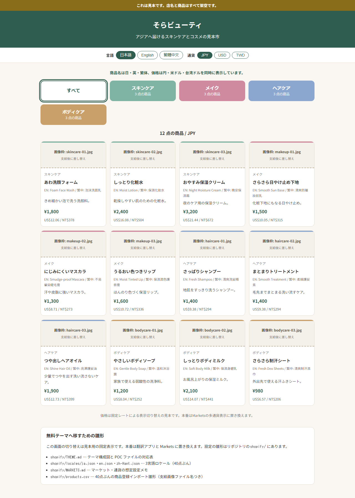
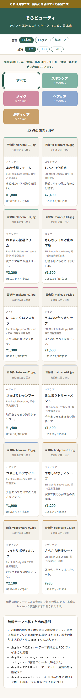

# 越境EC向け 多言語・多通貨カタログのPOC

海外向けに美容商品を売る想定の、商品カタログ画面の見本です。
画面上部に「これは見本です。店名と商品はすべて架空です」と表示しています。
開いてすぐ、4つのカテゴリー別に架空商品12点が並びます。
各商品には実画像の代わりの画像枠（支給画像ファイル名つき）、3言語の名前、
3通貨の価格が同時に載っています。言語と通貨のボタンで主表示が切り替わります。
外部サービスは使っていません。
無料テーマへ移すための雛形（テーマ構成図・3言語ロケール・Marketsメモ・40点CSV）は
`shopify/` に同梱しています。画面の切り替え自体は見本用の固定表示で、
本番は翻訳アプリと Markets に置き換える前提です。

## このPOCで確かめたこと

- 4つのカテゴリー（スキンケア・メイク・ヘアケア・ボディケア）別の商品絞り込みができる
- 3言語ぶんの商品名・説明文を持ち、切り替え表示ができる
- 固定レートによる3通貨の価格換算と記号つき表示ができる
- 対応外の言語・通貨が来ても日本語・日本円表示に落ち着く
- ロケール3言語ファイルが同じ40点の商品キーを持ち、空の名前・説明がない
- 商品CSV雛形が4カテゴリー×10点の40点で、支給形式の画像ファイル名が40点ぶん入っている
- CSVの日本語名と価格がロケールと一致し、見本12点の名前と画像名も一致している
- スマホ幅でも2列で崩れずに並ぶ

## 作っていない範囲

- Shopifyのテーマ・管理画面との連携（Liquid化やアプリ設定の作業）
- 商品詳細・会社概要・店舗情報・FAQ・お問い合わせ・利用規約などの各ページ
- 商品登録40点の本番データと実画像（見本12点と画像枠のみ。40点はCSV雛形）
- 決済・送料計算・カート・注文・在庫管理・会員登録
- 自動翻訳アプリとの連携や本物の為替レート取得（固定レートの見本表示のみ）
- 基本的なSEO設定

## 次の進め方

- 40点の支給データと画像を、CSV雛形の画像ファイル名に合わせて入れる
- テーマ構成図の対応表に沿って無料テーマに移し、3言語ロケールを翻訳アプリに読み込ませる
- 設定メモの想定に沿ってマーケット・多通貨・送料・決済を設定する
- 商品詳細などの各ページとSEO設定を足す

## 動かし方

- `docs/index.html` をブラウザで開くだけで動きます（サーバ不要）
- テスト: `npm install` 後に `npm test`（15件）
